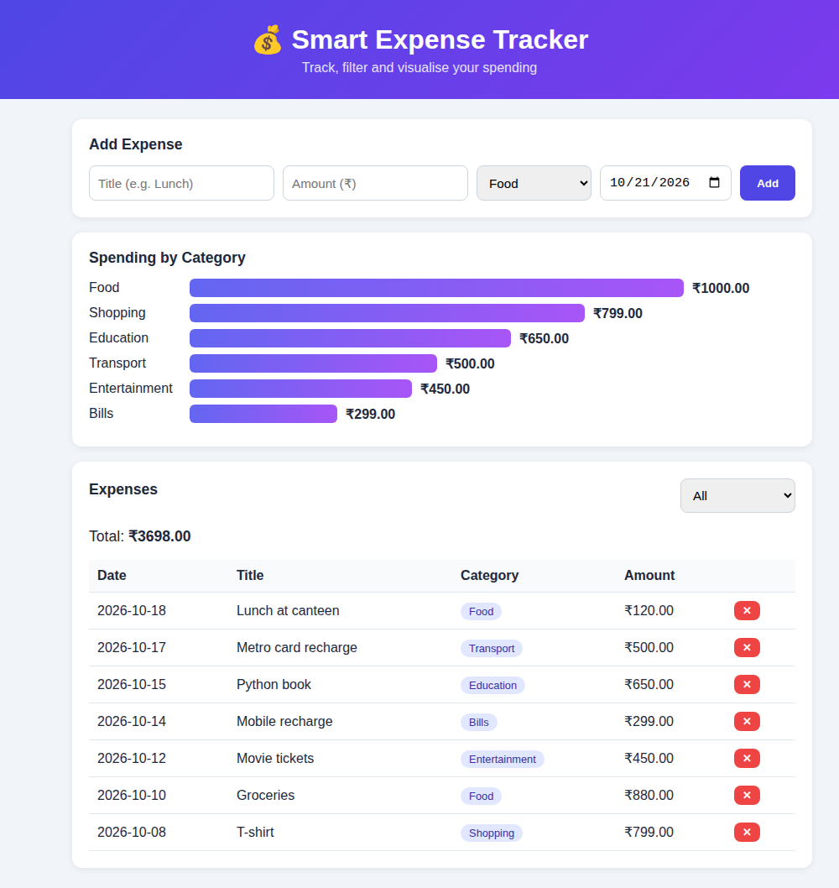
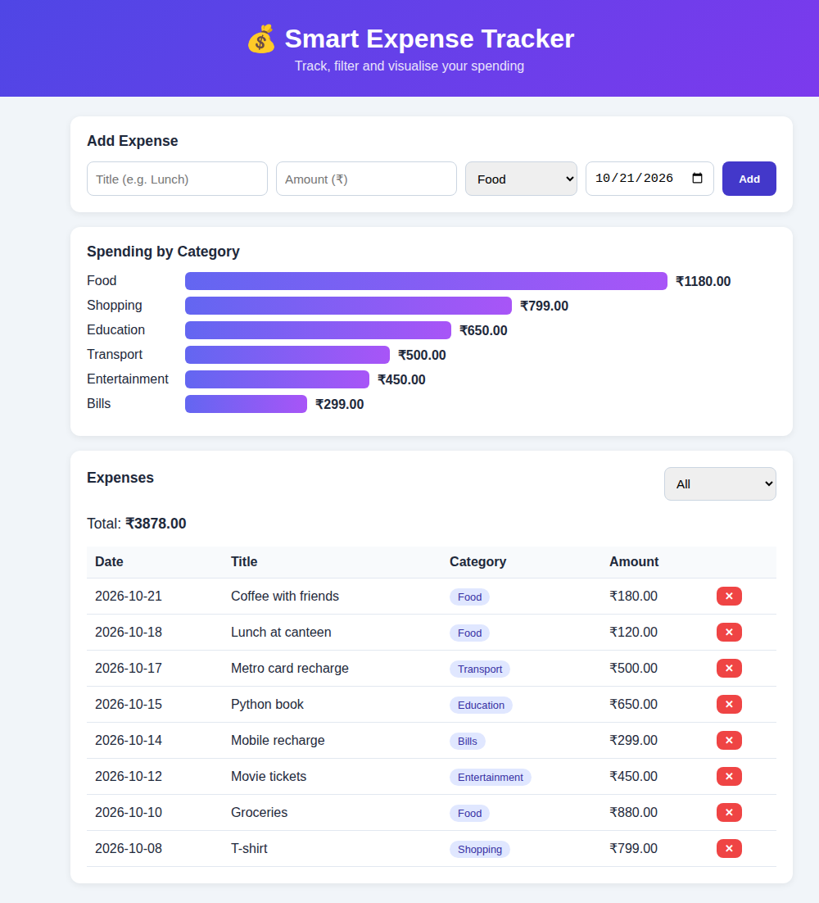
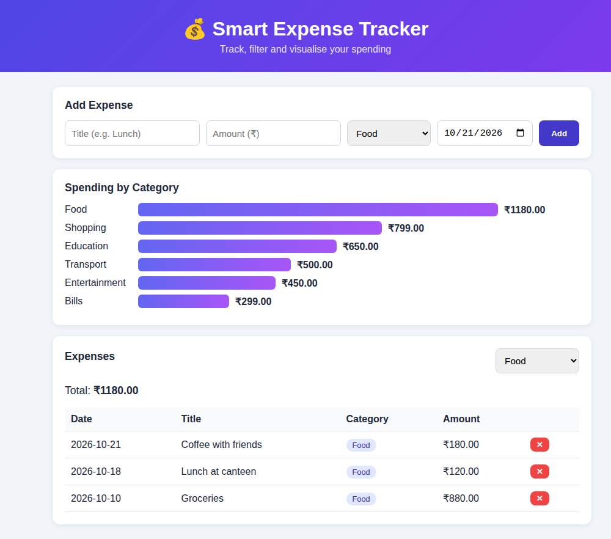

# 💰 Smart Expense Tracker

A full stack web application to record, filter and visualise personal expenses.
Built for **AAT-1 (Portfolio-Driven)** – Full Stack Technologies.

## Objective
To build a practical full stack application that lets a user log daily expenses, view the running total,
filter by category and see a spending breakdown chart — demonstrating frontend, backend, REST API and database integration.

## Description
- **Frontend:** HTML5, CSS3 (responsive grid), vanilla JavaScript (`fetch` API for the chart)
- **Backend:** Python Flask with Jinja2 templating and a JSON REST endpoint
- **Database:** SQLite (via Python `sqlite3`, parameterised queries)

### Features
- Add an expense (title, amount, category, date) with server-side validation
- Delete an expense
- Filter the list by category with a live total
- Category-wise spending bar chart drawn from `/api/summary`

## Tools / Technologies
Python 3.10+, Flask, SQLite, HTML, CSS, JavaScript, Git & GitHub

## Project Structure
```
Expense_Tracker/
├── app.py              # Flask routes, DB logic, REST API
├── seed_demo.py        # Optional sample data loader
├── requirements.txt
├── templates/index.html
├── static/style.css
├── static/app.js
└── screenshots/        # Output screenshots
```

## Execution Steps
```bash
git clone https://github.com/<your-username>/Smart_Expense_Tracker.git
cd Smart_Expense_Tracker
python -m venv venv
venv\Scripts\activate          # Linux/Mac: source venv/bin/activate
pip install -r requirements.txt
python seed_demo.py            # optional: load sample data
python app.py
```
Open **http://127.0.0.1:5000** in your browser.

## API
| Method | Route | Description |
|--------|-------|-------------|
| GET | `/` | Dashboard (supports `?category=Food`) |
| POST | `/add` | Add an expense |
| POST | `/delete/<id>` | Delete an expense |
| GET | `/api/summary` | JSON totals per category |

## Output




## Author
<Your Name> – USN: <Your USN>
